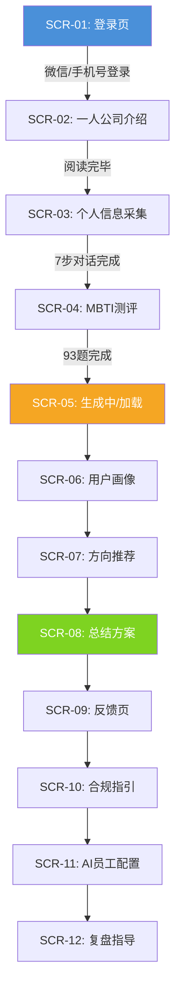

# SoloPilot 网页设计与交互规范文档

## 文档信息

| 字段 | 内容 |
|------|------|
| 文档名称 | SoloPilot 网页设计与交互规范 |
| 版本 | v1.0 |
| 创建日期 | 2026-04-18 |
| 关联文档 | SoloPilot-PRD.md |
| 适用范围 | 前端开发、UI/UX 设计、测试验收 |

---

## 1. 设计概览与目标

### 1.1 核心设计指标

| 指标 | 定义 | 目标值 |
|------|------|--------|
| 流程完成率 | 从登录到获取总结建议的用户占比 | >= 60% |
| 平均完成时长 | 从登录到获取建议的总交互时长 | <= 15 分钟 |
| 表单填写率 | 信息采集步骤中用户完成全部问题的比例 | >= 85% |
| MBTI 完答率 | 用户完成全部 93 题（或快速版）的比例 | >= 70% |
| 用户满意度 | 对推荐结果的评分均值 | >= 4.0 / 5.0 |

### 1.2 视觉调性关键词

| 关键词 | 含义 |
|--------|------|
| 专业 | 建议内容可信、数据有据，视觉上给人专家感 |
| 克制 | 不堆砌装饰，留白充分，信息密度适中 |
| 清晰 | 层级分明，用户一眼知道当前在做什么、下一步是什么 |
| 温暖 | 不是冷冰冰的工具感，而是像"一个懂行的朋友在帮你" |
| 高效 | 减少无效操作，对话式引导流畅自然，不做多余的事情 |

### 1.3 设计约束（来自 PRD）

- 全文使用大白话，禁止未经解释的专业术语（MVP、PMF、LTV、MRR 等）
- 严格禁止 emoji，界面中不出现任何表情符号
- 移动端优先设计，最低支持 375px 宽度
- 对话式引导每次只问一个问题，不一次展示多个表单字段
- 每个问题提供 3-5 个预设选项，保留"其他"空间
- 全流程需有进度指示

---

## 2. 用户旅程与界面流程

### 2.1 核心流程图



### 2.2 页面与界面 ID 映射

| 界面 ID | 页面名称 | PRD 页面 ID | 对应步骤 | 用户状态 |
|---------|----------|-------------|----------|----------|
| SCR-01 | 登录页 | P01 | S01 | 未认证 |
| SCR-02 | 一人公司介绍 | P02 | S02 | 浏览阶段 |
| SCR-03 | 个人信息采集 | P03 | S03 | 交互填写 |
| SCR-04 | MBTI 测评 | P04 | S04 | 问卷作答 |
| SCR-05 | 分析加载中 | -- | S05 | 等待生成 |
| SCR-06 | 用户画像展示 | P05 | S05 | 查看结果 |
| SCR-07 | 方向推荐 | P05 | S06 | 查看结果 |
| SCR-08 | 总结方案 | P05 | S07 | 查看结果 |
| SCR-09 | 反馈页 | P06 | S08 | 评价反馈 |
| SCR-10 | 合规指引 | P07 | S09 | 查看信息 |
| SCR-11 | AI 员工配置 | P08 | S10 | 测评+查看 |
| SCR-12 | 长期复盘 | P09 | S11 | 查看信息 |

### 2.3 用户情绪旅程

| 阶段 | 情绪状态 | 设计应对策略 |
|------|----------|-------------|
| 登录 | 中性/好奇 | 极简操作，微信一键登录 |
| 阅读介绍 | 新鲜/兴趣 | 分段展示，图文结合，可快速跳过 |
| 信息采集 | 轻松 | 对话式引导，进度可见，问题简单 |
| MBTI 测评 | 耐心递减 | 允许中断保存，支持快速版 |
| 等待加载 | 期待 | 动画+文案暗示"正在为你量身分析" |
| 查看结果 | 惊喜/认同 | 个性化展示，引用用户回答，数据可视化 |
| 反馈 | 满意/平淡 | 简短评分，1-2 题即可完成 |
| 后续页面 | 探索欲 | 结构化信息，可按需深入 |

---

## 3. 信息架构与导航设计

### 3.1 导航结构

主导航严格控制在 5 个一级入口（符合米勒定律）：

| 序号 | 入口名称 | 包含页面 | 访问频次 |
|------|----------|----------|----------|
| 1 | 首页 | SCR-02 介绍页 | 高 |
| 2 | 创业测评 | SCR-03 信息采集、SCR-04 MBTI | 高 |
| 3 | 我的方案 | SCR-06 画像、SCR-07 推荐、SCR-08 总结、SCR-09 反馈 | 高 |
| 4 | AI 团队 | SCR-11 AI 员工配置 | 中 |
| 5 | 合规与复盘 | SCR-10 合规指引、SCR-12 长期复盘 | 低 |

### 3.2 信息架构树

```
SoloPilot
|-- 首页
|   |-- 一人公司介绍（分模块滚动）
|       |-- 什么是一人公司
|       |-- 为什么值得关注
|       |-- 优势 vs 劣势
|       |-- 核心矛盾与解决思路
|       |-- 实操步骤
|       +-- 开始测评（CTA）
|
|-- 创业测评
|   |-- 个人信息采集（对话式，7步）
|   |   |-- Step 1: 所在城市
|   |   |-- Step 2: 性别（可选）
|   |   |-- Step 3: 工作强度喜好
|   |   |-- Step 4: 核心技能
|   |   |-- Step 5: 七大方向偏好
|   |   |-- Step 6: 成立目的
|   |   +-- Step 7: 工作时间偏好
|   +-- MBTI 测评
|       |-- Part 1: 情境行为题（1-26题）
|       +-- Part 2: 词语偏好题（27-93题）
|
|-- 我的方案
|   |-- 用户画像（标签 + 一段话描述）
|   |-- 方向推荐（2-3个方向卡片）
|   |-- 四型分类（保守/平衡/激进）
|   |-- 总结方案（完整报告）
|   +-- 用户反馈（满意度评分 + 开放式反馈）
|
|-- AI 团队
|   |-- AI 员工选择测评（10题）
|   |-- 推荐方案展示
|   |-- 角色详情（每个AI员工的具体信息）
|   +-- 搭建五步法指导
|
+-- 合规与复盘
    |-- 合规指引
    |   |-- 无公司运营指引
    |   |-- 公司注册指引
    |   +-- 税务基础指引
    +-- 长期复盘
        |-- 复盘模板
        +-- 周期提醒设置
```

### 3.3 高频功能突出策略（帕累托原则）

核心高频路径：登录 -> 测评 -> 查看方案，占总使用量的 80% 以上。

**突出策略**：
- 首页底部 CTA 按钮"开始测评"始终可见，视觉权重最高
- 导航中"创业测评"和"我的方案"使用品牌色高亮
- 低频功能（合规指引、复盘）收入第四、第五导航入口，使用默认文字色

---

## 4. 设计系统与组件规范

### 4.1 间距尺度

基于 4pt 栅格系统，确保全站间距一致性：

| Token 名称 | 数值 | 使用场景 |
|------------|------|----------|
| space-xs | 4px | 图标与文字间距、紧凑列表项间距 |
| space-sm | 8px | 相关元素内间距、小号按钮 padding |
| space-md | 16px | 卡片内 padding、段落间距 |
| space-lg | 24px | 区块间距、表单字段间距 |
| space-xl | 32px | 页面区块之间间距 |
| space-2xl | 48px | 大区块之间分隔 |
| space-3xl | 64px | 页面顶部/底部留白 |

### 4.2 字体系统

| Token 名称 | 大小 | 行高 | 字重 | 使用场景 |
|------------|------|------|------|----------|
| text-xs | 12px | 18px | 400 | 辅助说明、标签 |
| text-sm | 14px | 22px | 400 | 正文辅助文字 |
| text-base | 16px | 24px | 400 | 正文 |
| text-md | 18px | 28px | 400 | 强调正文 |
| text-lg | 20px | 30px | 500 | 小标题 |
| text-xl | 24px | 36px | 600 | 区块标题 |
| text-2xl | 30px | 40px | 700 | 页面标题 |
| text-3xl | 36px | 48px | 700 | 大标题（Hero） |

字体族：`"PingFang SC", "Hiragino Sans GB", "Microsoft YaHei", "Helvetica Neue", Arial, sans-serif`

### 4.3 颜色语义化

#### 主色系

| 名称 | 色值 | WCAG 对比度（白底） | 使用场景 |
|------|------|-------------------|----------|
| Brand-Primary | #2563EB | 4.6:1 | 主按钮、选中态、品牌标识 |
| Brand-Primary-Hover | #1D4ED8 | 5.7:1 | 按钮悬停态 |
| Brand-Primary-Light | #EFF6FF | -- | 选中卡片背景、浅色标签 |
| Brand-Primary-10 | #DBEAFE | -- | 进度条轨道、分割线 |

#### 中性色系

| 名称 | 色值 | 使用场景 |
|------|------|----------|
| Gray-900 | #111827 | 主标题文字 |
| Gray-700 | #374151 | 正文文字 |
| Gray-500 | #6B7280 | 辅助说明文字 |
| Gray-400 | #9CA3AF | 占位符、禁用文字 |
| Gray-200 | #E5E7EB | 边框、分割线 |
| Gray-100 | #F3F4F6 | 卡片背景、区块背景 |
| Gray-50 | #F9FAFB | 页面背景 |

#### 语义色系

| 名称 | 色值 | WCAG 对比度（白底） | 使用场景 |
|------|------|-------------------|----------|
| Success | #059669 | 4.6:1 | 完成状态、正向指标 |
| Success-Light | #ECFDF5 | -- | 成功提示背景 |
| Warning | #D97706 | 3.1:1 | 警告提示（仅用于图标+文字组合，不单独用作文字色） |
| Warning-Light | #FFFBEB | -- | 警告提示背景 |
| Error | #DC2626 | 4.6:1 | 错误提示、必填标记 |
| Error-Light | #FEF2F2 | -- | 错误提示背景 |
| Info | #2563EB | 4.6:1 | 信息提示 |

#### MBTI 四维度专属色

| 维度 | A 端色值 | B 端色值 | 使用场景 |
|------|----------|----------|----------|
| E/I | #F59E0B | #6366F1 | 外向 vs 内向 |
| S/N | #10B981 | #8B5CF6 | 实感 vs 直觉 |
| T/F | #3B82F6 | #EC4899 | 思考 vs 情感 |
| J/P | #F97316 | #14B8A6 | 判断 vs 知觉 |

### 4.4 组件状态机 -- 以 Button 为例

| 状态 | 背景色 | 文字色 | 边框 | 变换 | CSS 关键属性 |
|------|--------|--------|------|------|-------------|
| Default | #2563EB | #FFFFFF | none | none | cursor: pointer |
| Hover | #1D4ED8 | #FFFFFF | none | translateY(-1px) | transition: all 150ms |
| Active | #1E40AF | #FFFFFF | none | translateY(0) | -- |
| Focus | #2563EB | #FFFFFF | 2px solid #93C5FD, offset 2px | none | outline: none; box-shadow |
| Disabled | #93C5FD | #FFFFFF | none | none | cursor: not-allowed; opacity: 0.6 |
| Loading | #2563EB | transparent | none | none | 内嵌 spinner 动画 |

按钮尺寸规范：

| 尺寸 | 高度 | 水平 padding | 字号 | 圆角 |
|------|------|-------------|------|------|
| sm | 32px | 12px | 14px | 6px |
| md | 40px | 16px | 16px | 8px |
| lg | 48px | 24px | 18px | 8px |

### 4.5 圆角与阴影

| Token 名称 | 数值 | 使用场景 |
|------------|------|----------|
| radius-sm | 4px | 小标签、徽章 |
| radius-md | 8px | 按钮、输入框、小卡片 |
| radius-lg | 12px | 卡片、弹窗 |
| radius-xl | 16px | 大面板、底部弹窗 |
| radius-full | 9999px | 头像、胶囊按钮 |

| Token 名称 | 值 | 使用场景 |
|------------|-----|----------|
| shadow-sm | 0 1px 2px rgba(0,0,0,0.05) | 轻微浮起元素 |
| shadow-md | 0 4px 6px rgba(0,0,0,0.07) | 卡片、下拉面板 |
| shadow-lg | 0 10px 15px rgba(0,0,0,0.1) | 弹窗、浮层 |
| shadow-xl | 0 20px 25px rgba(0,0,0,0.15) | 模态框 |

### 4.6 Z-index 层级逻辑

| 层级 | Z-index 值 | 使用场景 |
|------|-----------|----------|
| Content | 0-9 | 页面内容 |
| Sticky | 10-19 | 粘性导航栏 |
| Header | 20-29 | 固定顶部导航 |
| Drawer | 30-39 | 侧边抽屉 |
| Modal-Overlay | 40-49 | 弹窗遮罩层 |
| Modal | 50-59 | 弹窗主体 |
| Tooltip | 60-69 | 提示气泡 |
| Toast | 70-79 | 全局消息提示 |

---

## 5. 关键页面设计规范

### 5.1 SCR-01 登录页

#### 布局结构

```
+--------------------------------------------------+
|                                                  |
|              SoloPilot Logo                       |
|        AI 驱动的一人公司创业规划助手              |
|                                                  |
|    +--------------------------------------+      |
|    |         [微信登录] 按钮               |      |
|    +--------------------------------------+      |
|                                                  |
|    ---- 或 ----                                  |
|                                                  |
|    +--------------------------------------+      |
|    |  手机号输入框                        |      |
|    +--------------------------------------+      |
|    +--------------------------------------+      |
|    |  验证码输入框       [获取验证码]      |      |
|    +--------------------------------------+      |
|    +--------------------------------------+      |
|    |         [登录] 按钮                   |      |
|    +--------------------------------------+      |
|                                                  |
|    登录即代表同意《用户协议》和《隐私政策》        |
|                                                  |
+--------------------------------------------------+
```

#### 交互逻辑

| 元素 ID | 触发动作 | 系统响应逻辑 | 异常/边界情况 |
|---------|----------|-------------|---------------|
| `btn-wechat` | Click | 调用微信授权登录 SDK，获取用户信息后跳转 SCR-02 | 微信未安装时隐藏该按钮或引导下载 |
| `input-phone` | Input | 实时校验手机号格式（11位数字），格式正确时 `btn-code` 可点击 | 非11位数字时 `btn-code` 显示为 disabled |
| `btn-code` | Click | 发送验证码，按钮进入 60s 倒计时，期间 disabled | 发送频率限制：同一号码 60s 内不可重发 |
| `input-code` | Input | 自动聚焦，输入 6 位后自动触发 `btn-login` 的 Click 事件 | 验证码过期（5分钟）提示"验证码已过期，请重新获取" |
| `btn-login` | Click | 调用登录接口，成功后跳转 SCR-02 | 手机号或验证码错误，按钮下方显示红色错误提示 |

#### 设计要点

- 移动端：垂直居中布局，全宽输入框
- 桌面端：卡片居中，卡片宽度 400px，背景使用浅色渐变
- 微信登录按钮使用微信绿色（#07C160），视觉层级最高
- 首次访问时自动聚焦手机号输入框

### 5.2 SCR-02 一人公司介绍页

#### 布局结构

```
+--------------------------------------------------+
| [Logo]  首页  创业测评  我的方案  AI团队  合规复盘 |
+--------------------------------------------------+
|                                                  |
|  +--------------------------------------------+ |
|  | Hero 区域                                   | |
|  | 你有没有过这样的想法？                       | |
|  | "不想再给别人打工了"                         | |
|  | "如果有一个 AI 团队帮我干活就好了"           | |
|  |                                            | |
|  | 了解一人公司 ----->                         | |
|  +--------------------------------------------+ |
|                                                  |
|  +--------------------------------------------+ |
|  | Section 1: 什么是一人公司                    | |
|  | 图文混排，通俗化解释                          | |
|  +--------------------------------------------+ |
|                                                  |
|  +--------------------------------------------+ |
|  | Section 2: 优势 vs 劣势                      | |
|  | 双栏对比卡片                                  | |
|  +--------------------------------------------+ |
|                                                  |
|  +--------------------------------------------+ |
|  | Section 3: 核心矛盾与解决思路               | |
|  | 图表+说明                                    | |
|  +--------------------------------------------+ |
|                                                  |
|  +--------------------------------------------+ |
|  | Section 4: 实操步骤                          | |
|  | 四步时间线                                    | |
|  +--------------------------------------------+ |
|                                                  |
|  +--------------------------------------------+ |
|  | CTA 区域                                    | |
|  | 已经了解了？看看你适合做什么                 | |
|  | [      开始测评      ]                       | |
|  +--------------------------------------------+ |
|                                                  |
+--------------------------------------------------+
```

#### 内容模块详细设计

**Hero 区域**：
- 背景色：Brand-Primary-Light（#EFF6FF）
- 标题：text-3xl（36px），字重 700，Gray-900
- 副标题引用语：text-lg（20px），斜体，Gray-700，左引号装饰
- CTA 按钮：Brand-Primary 色，lg 尺寸

**优势 vs 劣势对比卡片**：
- 左右双栏布局（移动端上下堆叠）
- 左卡片：Success-Light 背景，绿色左侧竖线
- 右卡片：Error-Light 背景，红色左侧竖线
- 每项使用列表形式，带勾/叉小图标

**实操步骤时间线**：
- 垂直时间线，4 个节点
- 节点用圆点+竖线连接
- 每个节点包含步骤编号、标题、简要说明

#### 交互逻辑

| 元素 ID | 触发动作 | 系统响应逻辑 | 异常/边界情况 |
|---------|----------|-------------|---------------|
| `nav-link-intro` | Click | 平滑滚动到对应 Section | -- |
| `cta-start` | Click | 跳转至 SCR-03 个人信息采集 | 未登录时跳转至 SCR-01 |
| 各 Section | Scroll into view | 导航栏对应项高亮 | IntersectionObserver 阈值 0.3 |

### 5.3 SCR-03 个人信息采集页

#### 布局结构（对话式）

```
+--------------------------------------------------+
| [返回]                        Step 3 / 7         |
+--------------------------------------------------+
|                                                  |
|  进度: ==========>                    42%         |
|                                                  |
|  +--------------------------------------------+ |
|  | AI 助手气泡                                | |
|  | "在你目前的工作或生活中，你最擅长什么？"     | |
|  | "不需要很专业，哪怕是'很会整理东西'也可以。" | |
|  +--------------------------------------------+ |
|                                                  |
|  +--------------------------------------------+ |
|  | +----------+ +----------+ +----------+     | |
|  | | 写作内容 | | 编程技术 | | 设计美术 |     | |
|  | +----------+ +----------+ +----------+     | |
|  | +----------+ +----------+ +----------+     | |
|  | | 销售商务 | | 教学培训 | | 行业专业 |     | |
|  | +----------+ +----------+ +----------+     | |
|  | +----------+ +----------+                 | |
|  | | 暂不确定 | |  其他    |                 | |
|  | +----------+ +----------+                 | |
|  +--------------------------------------------+ |
|                                                  |
|  +--------------------------------------------+ |
|  | 用户已选择气泡                              | |
|  | "我选的是：写作内容"                        | |
|  +--------------------------------------------+ |
|                                                  |
+--------------------------------------------------+
```

#### 七步对话内容设计

| Step | 问题文案 | 选项类型 | 选项内容 |
|------|----------|----------|----------|
| 1 | "你现在所在的城市属于哪个等级？" | 单选卡片（4个） | 一线城市 / 新一线城市 / 二线城市 / 三线及以下 |
| 2 | "你的性别是？（这个是可选的）" | 单选卡片（2个）+ 跳过 | 男 / 女 / "跳过这一步" |
| 3 | "你比较偏好怎样的工作节奏？" | 单选卡片（4个） | 007 / 996 / 965 / 越少工作越好 |
| 4 | "在你目前的工作或生活中，你最擅长什么？" | 单选卡片（8个） | 写作内容 / 编程技术 / 设计美术 / 销售商务 / 教学培训 / 行业专业 / 暂不确定 / 其他 |
| 5 | "以下哪个方向最让你心动？" | 单选卡片（7个） | 知识付费与内容创作 / 独立开发与微型SaaS / 专业技能咨询与服务 / 跨境与利基电商 / AI驱动的服务业务 / 实体轻服务 / 信息中介与资源对接 |
| 6 | "你想成立一人公司，最主要是为了什么？" | 文本输入 + 快捷选项 | 文本框 + 下方4个快捷标签："增加收入" / "时间自由" / "实现想法" / "不再打工" |
| 7 | "你更适合哪种工作时间安排？" | 单选卡片（3个） | 固定时间坐班型 / 零碎工作时间类型 / 都可以 |

#### 交互逻辑

| 元素 ID | 触发动作 | 系统响应逻辑 | 异常/边界情况 |
|---------|----------|-------------|---------------|
| `option-card` | Click | 选中状态高亮（品牌色边框+背景），0.5s 后自动进入下一步 | 选"其他"时弹出文本输入框 |
| `input-other` | Submit | 存储自定义文本，进入下一步 | 空文本不允许提交 |
| `btn-skip` | Click | 该字段标记为"未填写"，直接进入下一步 | 仅 Step 2（性别）可跳过 |
| `btn-back` | Click | 回到上一步，保留已填写的选项 | 第一步时按钮 disabled |
| 进度条 | -- | 随步骤推进更新百分比 | 中断后再次进入，从上次步骤继续 |

#### 设计要点

- 每步只展示一个问题，避免认知负荷（希克定律）
- 选项卡片尺寸：最小触控区域 44x44px（符合菲茨定律）
- 选中的卡片有 150ms 的缩放动画（scale 0.98 -> 1.0），提供触觉反馈感
- 进度条使用渐变色（从浅到深的品牌色），每步推进有过渡动画
- Step 6 的文本输入框高度 80px，placeholder 文案："简单说说你的想法..."
- AI 助手气泡：左侧，浅灰背景（#F3F4F6），左上角圆角较小
- 用户回答气泡：右侧，品牌色背景（#2563EB），白色文字，右上角圆角较小

### 5.4 SCR-04 MBTI 测评页

#### 布局结构

```
+--------------------------------------------------+
| [返回]              第 15 / 93 题        [保存退出]|
+--------------------------------------------------+
|                                                  |
|  进度: =========================>      16%       |
|                                                  |
|  第一部分：情境行为题                             |
|                                                  |
|  +--------------------------------------------+ |
|  |                                            | |
|  |  题目 15                                   | |
|  |                                            | |
|  |  你会跟哪些人做朋友？                      | |
|  |                                            | |
|  +--------------------------------------------+ |
|                                                  |
|  +--------------------------------------------+ |
|  |                                            | |
|  |  [  A ] 常提出新主意的                    | |
|  |                                            | |
|  +--------------------------------------------+ |
|                                                  |
|  +--------------------------------------------+ |
|  |                                            | |
|  |  [  B ] 脚踏实地的                        | |
|  |                                            | |
|  +--------------------------------------------+ |
|                                                  |
|                                                  |
+--------------------------------------------------+
```

#### 交互逻辑

| 元素 ID | 触发动作 | 系统响应逻辑 | 异常/边界情况 |
|---------|----------|-------------|---------------|
| `option-a` / `option-b` | Click | 记录选择，300ms 后自动跳转到下一题 | 点击后 300ms 内禁止重复点击 |
| `btn-back` | Click | 回到上一题，保留之前的选择 | 第一题时按钮 disabled |
| `btn-save-quit` | Click | 保存当前进度到 localStorage，弹出确认弹窗 | 弹窗文案："你的进度已保存，下次可以继续。" |
| `btn-fast-mode` | Click (仅前3题可见) | 弹出确认弹窗，切换到快速版（约30题） | 切换后不可恢复完整版 |

#### 设计要点

- 每题占满屏幕中央区域，减少干扰
- 选项 A/B 为全宽大按钮，高度 56px，便于触控
- 选中后有品牌色左边框 + 背景色变化
- 进度条在顶部固定，始终可见
- 第 1-26 题顶部显示"第一部分：情境行为题"
- 第 27 题开始顶部切换为"第二部分：词语偏好题"，有短暂分隔动画
- 支持键盘操作：A 键选 A，B 键选 B

### 5.5 SCR-05 分析加载页

#### 布局结构

```
+--------------------------------------------------+
|                                                  |
|                                                  |
|                                                  |
|              [SoloPilot Logo 动画]               |
|                                                  |
|         正在为你生成专属创业方案...               |
|                                                  |
|              分析中 67%                           |
|                                                  |
|         +--------------------------------+       |
|         | 正在匹配适合你的行业方向...      |       |
|         +--------------------------------+       |
|                                                  |
|                                                  |
+--------------------------------------------------+
```

#### 设计要点

- 加载时长控制：至少 3 秒（营造期待感），最多不超过 8 秒
- Logo 使用脉冲动画（缩放 1.0 -> 1.05 -> 1.0，循环 1.5s）
- 进度百分比和提示文案联动：
  - 0-30%："正在分析你的性格特征..."
  - 30-60%："正在匹配适合你的行业方向..."
  - 60-90%："正在生成个性化创业方案..."
  - 90-100%："马上就好..."
- 实际上后台计算可能在 1s 内完成，前端使用动画填充剩余时间
- 加载完成后自动跳转 SCR-06

### 5.6 SCR-06/07/08 结果展示页（三合一长页面）

这三个页面合并为可滚动的长页面，各区块之间有视觉分隔。

#### 布局结构

```
+--------------------------------------------------+
| [Logo]  首页  创业测评  [我的方案]  AI团队  合规复盘|
+--------------------------------------------------+

== 区块一：用户画像 ==

+--------------------------------------------+
| 你的创业画像                                |
|                                            |
| +------+ +------+ +------+ +------+       |
| |一线城| |写作  | |ENFP  | |平衡型|       |
| +------+ +------+ +------+ +------+       |
|                                            |
| "你是一个生活在一线城市、擅长内容创作、      |
|  性格开放热情的创业者。你适合从多个方向      |
|  中选择最优解，逐步验证并放大。"             |
+--------------------------------------------+

== 区块二：方向推荐 ==

+--------------------------------------------+
| 为你推荐的方向                              |
|                                            |
| +--------------------------------------+  |
| | 推荐 1：知识付费与内容创作           |  |
| | 匹配度：92%                          |  |
| |                                      |  |
| | 为什么适合你：                        |  |
| | "你的核心技能是写作内容，这与知识     |  |
| |  付费方向高度匹配。ENFP 型的你擅长    |  |
| |  发现新机会、与人建立连接..."          |  |
| |                                      |  |
| | 预期收入：月入 5,000 - 30,000 元     |  |
| | [查看详情 >]                         |  |
| +--------------------------------------+  |
|                                            |
| +--------------------------------------+  |
| | 推荐 2：AI 驱动的服务业务            |  |
| | 匹配度：85%                          |  |
| | ...                                  |  |
| +--------------------------------------+  |
|                                            |
| +--------------------------------------+  |
| | 推荐 3：实体轻服务（备选）            |  |
| | 匹配度：78%                          |  |
| | ...                                  |  |
| +--------------------------------------+  |
+--------------------------------------------+

== 区块三：四型分类 ==

+--------------------------------------------+
| 你的创业类型：平衡型                        |
|                                            |
| 你目前的情况比较灵活，有时间和空间尝试      |
| 不同方向。建议先选择 1 个方向用 3 个月      |
| 验证，成功后再考虑加大投入。                |
+--------------------------------------------+

== 区块四：总结方案 ==

+--------------------------------------------+
| 你的专属创业方案                            |
|                                            |
| | 你的画像       | 一句话概括            |  |
| | 推荐方向       | Top 2-3 及理由       |  |
| | 策略建议       | 营销优先 vs 开发优先  |  |
| | 城市建议       | 基于现状的建议        |  |
| | 首月行动清单   | 30天可执行步骤        |  |
| | 预期时间线     | 首笔收入的中性预期    |  |
|                                            |
| [下载报告]  [开始反馈]                      |
+--------------------------------------------+
```

#### 交互逻辑

| 元素 ID | 触发动作 | 系统响应逻辑 | 异常/边界情况 |
|---------|----------|-------------|---------------|
| `tag-profile` | -- | 用户画像标签组，引用用户具体回答生成 | -- |
| `card-direction` | Click | 展开该方向的详细信息（参考案例、启动建议） | 再次点击收起 |
| `progress-bar-match` | -- | 匹配度使用动画进度条（0 -> 目标值，1.5s） | 匹配度数值由后台算法计算 |
| `btn-download` | Click | 生成 PDF 版报告并下载 | PDF 生成失败时提示"请稍后重试" |
| `btn-feedback` | Click | 滚动至反馈区域或跳转至 SCR-09 | -- |

#### 设计要点

- 用户画像标签组：4 个标签横排（移动端 2x2），每个标签用品牌色背景 + 白色文字
- 方向推荐卡片：匹配度百分比使用品牌色环形进度条或横向进度条
- "为什么适合你"部分必须引用用户的具体回答（如"你在第 4 步选择的核心技能是写作内容"）
- 总结方案使用表格或结构化列表呈现，便于快速扫描
- 首月行动清单使用 checkbox 样式，用户可勾选已完成的步骤

### 5.7 SCR-09 反馈页

#### 布局结构

```
+--------------------------------------------------+
| [返回]                    用户反馈                 |
+--------------------------------------------------+
|                                                  |
|  你的建议还满意吗？                               |
|                                                  |
|  +------+ +------+ +------+ +------+ +------+   |
|  |  1   | |  2   | |  3   | |  4   | |  5   |   |
|  | 很差 | | 较差 | | 一般 | | 不错 | | 很好 |   |
|  +------+ +------+ +------+ +------+ +------+   |
|                                                  |
|  你目前最大的困惑是什么？                         |
|  +------------------------------------------+   |
|  |                                          |   |
|  |  （文本输入区域，高度 120px）             |   |
|  |                                          |   |
|  +------------------------------------------+   |
|                                                  |
|  +------------------------------------------+   |
|  |            [提交反馈]                      |   |
|  +------------------------------------------+   |
|                                                  |
+--------------------------------------------------+
```

#### 交互逻辑

| 元素 ID | 触发动作 | 系统响应逻辑 | 异常/边界情况 |
|---------|----------|-------------|---------------|
| `rating-star` | Click | 选中的星级高亮（填充），未选中的灰色 | 必须选择至少 1 星才能提交 |
| `input-feedback` | Input | 字数统计显示在右下角（如"23/500"） | 最大 500 字 |
| `btn-submit` | Click | 提交反馈，显示成功提示"感谢你的反馈！"，3s 后跳转 SCR-10 | 未评分时按钮 disabled |

### 5.8 SCR-11 AI 员工配置页

#### 布局结构

```
+--------------------------------------------------+
| [返回]                    AI 团队配置             |
+--------------------------------------------------+
|                                                  |
|  你适合哪种 AI 团队？完成 10 个问题即可获得       |
|  个性化推荐。                                     |
|                                                  |
|  [开始测评]                                       |
|                                                  |
|  ---- 或查看所有方案 ----                         |
|                                                  |
|  +------+ +------+ +------+ +------+ +------+ +----+
|  |方案A | |方案B | |方案C | |方案D | |方案E | |方案F|
|  |内容创| |产品运| |技术创| |咨询教| |电商卖| |起步探|
|  |作者型| |营型  | |业者型| |练型  | |家型  | |索型 |
|  +------+ +------+ +------+ +------+ +------+ +----+
|                                                  |
+--------------------------------------------------+
```

#### 测评结果展示

```
+--------------------------------------------------+
| 你的 AI 团队方案：内容创作者型                    |
|                                                  |
| 推荐角色（按优先级排序）：                        |
|                                                  |
| +--------------------------------------------+  |
| | 1. 内容创作助手  [展开详情]                  |  |
| |    帮你解决：每天自动生成 3-5 篇内容        |  |
| |    预期效果：从"没东西发"变"选哪篇发"      |  |
| |                                            |  |
| |    展开后详情：                             |  |
| |    - 它能做什么：...                        |  |
| |    - 它做不了什么：...                      |  |
| |    - 你需要提供什么：...                    |  |
| |    - 推荐工具：Coze、Dify                  |  |
| |    - 预估月费：50-100 元                   |  |
| +--------------------------------------------+  |
|                                                  |
| [2. 社媒运营员] [3. SEO优化师] [4. 配图生成器]  |
|                                                  |
+--------------------------------------------------+
```

#### 搭建五步法展示

```
+--------------------------------------------------+
| 搭建五步法                                        |
|                                                  |
|  (1) 梳理业务流程 ---> (2) 选择最痛点搭建首个      |
|                                      |           |
|  (5) 持续迭代优化 <--- (4) 串联多个 Agent          |
|                <--- (3) 封装工作流                |
+--------------------------------------------------+
```

### 5.9 SCR-10 合规指引页 & SCR-12 长期复盘页

这两个页面使用 Tab 式切换：

```
+--------------------------------------------------+
| [合规指引]    [长期复盘]                           |
+--------------------------------------------------+
|                                                  |
|  合规指引 Tab 下：                                |
|  +--------------------------------------------+ |
|  | 1. 无公司运营指引                            | |
|  |   支付 / 用户登录 / 消息触达 解决方案        | |
|  +--------------------------------------------+ |
|  | 2. 公司注册指引                              | |
|  |   个体工商户 vs 有限责任公司 对比            | |
|  +--------------------------------------------+ |
|  | 3. 税务基础指引                              | |
|  |   常见税务注意事项                           | |
|  +--------------------------------------------+ |
|                                                  |
|  长期复盘 Tab 下：                                |
|  +--------------------------------------------+ |
|  | 复盘周期设置：[周] [月] [季度]               | |
|  +--------------------------------------------+ |
|  | 复盘模板：                                   | |
|  | - 本期收入：___                              | |
|  | - 本期流量：___                              | |
|  | - 本期客户数：___                            | |
|  | - 效率改善：___                              | |
|  | - 下期目标：___                              | |
|  +--------------------------------------------+ |
|  | [保存复盘记录]                               | |
|  +--------------------------------------------+ |
+--------------------------------------------------+
```

---

## 6. 响应式断点策略

### 6.1 断点定义

| 断点名称 | 宽度范围 | 栅格列数 | 内容区最大宽度 | 侧边边距 |
|----------|----------|----------|---------------|----------|
| Mobile | 375-767px | 4 列 | 100% | 16px |
| Tablet | 768-1023px | 8 列 | 720px | 24px |
| Desktop | 1024-1439px | 12 列 | 960px | 32px |
| Wide | 1440px+ | 12 列 | 1200px | 居中 |

### 6.2 关键组件折叠规则

| 组件 | Mobile | Tablet | Desktop |
|------|--------|--------|---------|
| 导航栏 | 底部 Tab 栏（5 个图标入口） | 顶部导航，文字缩写 | 顶部导航，完整文字 |
| 介绍页 Hero | 单列，文字居中 | 单列，文字左对齐 | 双列（文字+配图） |
| 优势/劣势对比 | 上下堆叠 | 上下堆叠 | 左右双栏 |
| 信息采集选项 | 2 列网格 | 3 列网格 | 4 列网格 |
| MBTI 选项 A/B | 全宽纵向排列 | 全宽纵向排列 | 全宽纵向排列 |
| 方向推荐卡片 | 单列堆叠 | 单列堆叠 | 单列堆叠 |
| AI 员工方案卡片 | 2 列网格 | 3 列网格 | 6 列网格 |
| 结果页画像标签 | 2x2 网格 | 4 列横排 | 4 列横排 |
| 反馈评分星 | 5 星横排 | 5 星横排 | 5 星横排 |

### 6.3 底部导航栏规范（Mobile）

移动端使用底部 Tab 栏替代顶部导航：

```
+--------------------------------------------------+
|                                                  |
|              （页面内容区域）                      |
|                                                  |
+--------------------------------------------------+
| [首页]  [测评]  [方案]  [AI]  [更多]             |
|  (图)    (图)    (图)    (图)   (图)              |
|  文字    文字    文字    文字   文字               |
+--------------------------------------------------+
```

- 高度：56px + 安全区域底部间距
- 当前选中项：图标和文字使用 Brand-Primary 色
- 未选中项：Gray-400 图标 + Gray-500 文字
- 图标尺寸：24x24px
- 文字大小：10px

---

## 7. 动效规范

### 7.1 过渡时间

| 类型 | 时长 | 缓动函数 | 使用场景 |
|------|------|----------|----------|
| 快速反馈 | 100ms | ease-out | 按钮按下、选中状态 |
| 标准过渡 | 200ms | ease-in-out | 卡片展开/收起、Tab 切换 |
| 页面切换 | 300ms | ease-in-out | 路由跳转、模态框出现 |
| 入场动画 | 400ms | cubic-bezier(0.25, 0.46, 0.45, 0.94) | 页面元素首次进入 |
| 复杂动画 | 600ms | cubic-bezier(0.34, 1.56, 0.64, 1) | 加载完成、成功反馈 |

### 7.2 核心动效

| 动效名称 | 描述 | 触发条件 |
|----------|------|----------|
| 进度条推进 | 宽度平滑增加，带渐变色 | 每完成一步信息采集/MBTI 答题 |
| 选项选中脉冲 | 卡片 scale 0.98 -> 1.0 + 品牌色渐显 | 点击选项卡片 |
| 结果揭示 | 从透明度 0 + translateY(20px) 到最终位置 | 结果页面加载完成 |
| 气泡出现 | 从下方滑入 + 淡入 | 对话式引导每步新内容出现 |
| 加载呼吸 | Logo 缩放 1.0 -> 1.05 -> 1.0 循环 | 加载页面 |
| 成功庆祝 | 品牌色圆形扩散 + 勾号出现 | 提交反馈成功 |

### 7.3 动效原则

- 所有动效必须尊重 `prefers-reduced-motion` 系统设置，减弱动画用户看到即时状态切换
- 同一页面内动效时长保持一致，避免视觉混乱
- 动效服务于功能，不为装饰而动效

---

## 8. 反馈机制设计

### 8.1 系统状态反馈（多尔蒂门槛）

| 状态类型 | 反馈方式 | 响应时间要求 |
|----------|----------|-------------|
| 按钮点击 | 按钮缩放 + 背景色加深 | 即时（< 100ms） |
| 表单提交 | 按钮 Loading 状态（spinner） | < 300ms |
| 页面跳转 | 路由过渡动画 | < 100ms |
| 数据加载 | Skeleton 占位符 或 进度指示器 | < 300ms |
| 操作成功 | Toast 提示（顶部滑入，3s 后自动消失） | < 500ms |
| 操作失败 | 行内错误提示（红色文字，在操作元素下方） | < 500ms |

### 8.2 空状态设计（峰终定律）

| 页面 | 空状态场景 | 展示内容 |
|------|-----------|----------|
| 我的方案 | 尚未完成测评 | 插图 + "你还没有完成创业测评" + [开始测评] 按钮 |
| AI 团队 | 尚未完成 AI 测评 | 插图 + "先完成测评，获得专属 AI 团队推荐" + [开始测评] 按钮 |
| 长期复盘 | 没有复盘记录 | 插图 + "开始你的第一次复盘" + [创建复盘] 按钮 |
| 反馈 | 已提交反馈 | 成功图标 + "感谢你的反馈，我们会持续优化推荐结果" |

### 8.3 错误处理

| 错误场景 | 处理方式 |
|----------|----------|
| 网络断开 | 顶部黄色横幅提示"网络连接已断开，请检查网络"，操作按钮 disabled |
| 接口超时 | Toast 提示"请求超时，请稍后重试"，提供"重试"按钮 |
| 表单校验失败 | 对应字段下方显示红色提示文字，字段边框变红 |
| 登录过期 | 弹窗提示"登录已过期"，引导重新登录，跳转 SCR-01 |
| 数据丢失 | 严重错误页：插图 + "出了点问题" + [返回首页] 按钮 |

---

## 9. 可访问性要求

### 9.1 基础要求

| 要求 | 标准 |
|------|------|
| 颜色对比度 | 文字与背景对比度 >= 4.5:1（WCAG AA），大文字 >= 3:1 |
| 键盘导航 | 所有交互元素可通过 Tab 键访问，Enter/Space 激活 |
| 焦点指示 | 所有可聚焦元素有明显的 focus 环（2px solid Brand-Primary，offset 2px） |
| 文字大小 | 正文不小于 14px，禁止使用 12px 以下的文字 |
| 触控目标 | 移动端所有可点击元素最小 44x44px |

### 9.2 ARIA 标签

| 元素 | ARIA 标签 |
|------|-----------|
| 导航栏 | `role="navigation"`, `aria-label="主导航"` |
| 进度条 | `role="progressbar"`, `aria-valuenow`, `aria-valuemin`, `aria-valuemax` |
| 评分星 | `role="radiogroup"`, 每颗星 `role="radio"`, `aria-checked` |
| 对话气泡 | AI 助手气泡 `aria-label="系统消息"`, 用户气泡 `aria-label="你的回答"` |
| Toast | `role="alert"`, `aria-live="polite"` |
| 模态框 | `role="dialog"`, `aria-modal="true"`, `aria-labelledby` |

---

## 10. UX 设计自检清单

基于十项 UX 基石原则的自检问卷：

### 雅各布定律（用户心智模型）

| 编号 | 自检项 | 通过 |
|------|--------|------|
| J1 | 导航结构是否与用户常见的产品导航范式一致？ | |
| J2 | 对话式采集是否符合用户对"AI 助手"的预期行为？ | |
| J3 | 进度指示是否清晰，用户是否知道自己在流程中的位置？ | |

### 菲茨定律（操作效率）

| 编号 | 自检项 | 通过 |
|------|--------|------|
| F1 | 所有可点击元素的触控区域是否 >= 44x44px？ | |
| F2 | 高频操作按钮（如选项卡片）是否足够大且间距充足？ | |
| F3 | 移动端底部导航是否方便拇指触及？ | |

### 希克定律（降低决策成本）

| 编号 | 自检项 | 通过 |
|------|--------|------|
| H1 | 信息采集是否每步只展示一个问题？ | |
| H2 | 每个问题的选项是否控制在 3-5 个（加"其他"）？ | |
| H3 | 结果页是否分模块展示，避免信息过载？ | |

### 米勒定律（信息分组）

| 编号 | 自检项 | 通过 |
|------|--------|------|
| M1 | 一级导航是否控制在 5 个以内？ | |
| M2 | 结果页的各个板块是否有清晰的视觉分隔？ | |
| M3 | MBTI 四维度结果是否分组展示？ | |

### 特斯勒定律（复杂性守恒）

| 编号 | 自检项 | 通过 |
|------|--------|------|
| T1 | 用户不需要理解的复杂性是否由系统承担（如计分逻辑）？ | |
| T2 | MBTI 测评是否提供了快速版选项以降低用户负担？ | |

### 多尔蒂门槛（系统响应速度）

| 编号 | 自检项 | 通过 |
|------|--------|------|
| D1 | 所有按钮点击是否有 < 100ms 的视觉反馈？ | |
| D2 | 加载状态是否有 Skeleton 或进度指示器？ | |
| D3 | 操作成功/失败是否有明确的反馈提示？ | |

### 格式塔原理（视觉组织）

| 编号 | 自检项 | 通过 |
|------|--------|------|
| G1 | 相关选项是否通过接近性分组（如卡片组）？ | |
| G2 | 同类元素是否使用一致的视觉样式（相似性）？ | |
| G3 | 对话式引导的 AI 气泡和用户气泡是否有明确的视觉区分？ | |

### 美学可用性效应（建立信任）

| 编号 | 自检项 | 通过 |
|------|--------|------|
| A1 | 整体视觉是否专业、克制，不花哨？ | |
| A2 | 建议结果是否包含数据支撑和用户个性化信息？ | |
| A3 | 推荐方向是否有真实案例支撑？ | |

### 帕累托原则（突出高频功能）

| 编号 | 自检项 | 通过 |
|------|--------|------|
| P1 | "创业测评"和"我的方案"在导航中是否视觉突出？ | |
| P2 | 核心流程（登录->测评->方案）是否路径最短？ | |
| P3 | 低频功能（合规、复盘）是否收纳至次要入口？ | |

### 峰终定律（体验记忆管理）

| 编号 | 自检项 | 通过 |
|------|--------|------|
| PE1 | 结果展示页是否是体验高峰（视觉吸引力强、信息个性化）？ | |
| PE2 | 反馈提交后是否有积极的终峰体验（成功提示+引导下一步）？ | |
| PE3 | 全流程完成后的最终页面是否给用户清晰的价值感？ | |

---

## 11. 交付物清单

### 11.1 设计交付物

| 文件 | 格式 | 命名规范 |
|------|------|----------|
| 设计稿 | Figma 链接 | 按页面命名（如 SCR-01-Login, SCR-03-Info-Collect） |
| 图标资源 | SVG | `solopilot-[类别]-[名称].svg`（如 solopilot-nav-home.svg） |
| 插图资源 | SVG / PNG@2x | `solopilot-illus-[场景].svg` |
| Logo | SVG + PNG | `solopilot-logo.svg`, `solopilot-logo-dark.svg` |

### 11.2 标注交付

| 文件 | 内容 |
|------|------|
| 尺寸标注 | 间距、字号、圆角、阴影参数 |
| 颜色标注 | 每个元素使用的 Token 名称和具体色值 |
| 状态标注 | 各组件的 Default / Hover / Active / Disabled / Focus 状态 |
| 动效标注 | 过渡时间、缓动函数、关键帧描述 |

### 11.3 前端协作

| 文件 | 说明 |
|------|------|
| Design Token 文件 | JSON 格式的颜色、间距、字体 Token，直接用于前端变量 |
| 组件状态文档 | 每个组件的所有状态说明及 CSS 关键属性 |
| 响应式标注 | 各断点下的布局变化说明 |
